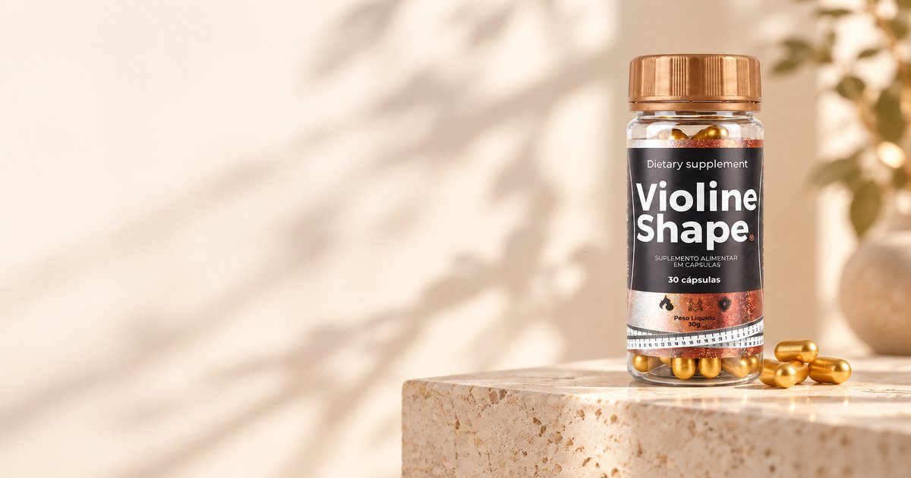

# Landing Page Violine Shape

Landing page oficial do **Violine Shape**, disponibilizada para afiliados autorizados divulgarem o produto com seus próprios links de venda.

> **Afiliado:** baixe o projeto, substitua os quatro links de checkout pelos seus links de afiliado e publique. A página já está pronta e não exige instalação, banco de dados ou processo de compilação.

[](https://violineshape.com.br/)

## Página publicada

**Landing page:** https://violineshape.com.br/

## O que você precisa alterar

Todos os links de compra ficam no arquivo [`site/index.html`](site/index.html), na seção de ofertas. Procure pelos quatro botões com a classe `js-checkout`:

```html
<a class="js-checkout" data-kit="1" href="COLE_AQUI_SEU_LINK_DE_AFILIADO">Comprar 1 frasco</a>
<a class="js-checkout" data-kit="2" href="COLE_AQUI_SEU_LINK_DE_AFILIADO">Comprar 2 frascos</a>
<a class="js-checkout" data-kit="3" href="COLE_AQUI_SEU_LINK_DE_AFILIADO">Comprar 3 frascos</a>
<a class="js-checkout" data-kit="5" href="COLE_AQUI_SEU_LINK_DE_AFILIADO">Quero o kit completo</a>
```

Substitua somente o conteúdo entre aspas do atributo `href`. Mantenha as classes e os atributos `data-kit` e `data-value`, pois eles são usados pelo rastreamento.

Cada botão corresponde a uma oferta:

| `data-kit` | Oferta exibida na página |
|---|---|
| `1` | 1 frasco · tratamento de 1 mês |
| `2` | 2 frascos · tratamento de 2 meses + 4 e-books |
| `3` | 3 frascos · tratamento de 3 meses + 4 e-books |
| `5` | 5 frascos · tratamento de 5 meses + 4 e-books |

Use o link de afiliado correspondente a cada oferta. Depois de editar, teste os quatro botões de compra antes de iniciar a divulgação.

## Como copiar o projeto

### Opção 1: criar seu próprio repositório

1. Clique em **Fork** no topo deste repositório.
2. Crie a cópia na sua conta do GitHub.
3. Abra `site/index.html` no seu repositório.
4. Clique no ícone de lápis para editar.
5. Procure por `js-checkout` e troque os quatro valores de `href`.
6. Salve em **Commit changes**.

Essa é a opção mais simples para publicar pela Vercel sem instalar ferramentas no computador.

### Opção 2: baixar o arquivo ZIP

1. Clique em **Code** no topo deste repositório.
2. Clique em **Download ZIP**.
3. Extraia o arquivo no computador.
4. Abra `site/index.html` em um editor de texto ou de código.
5. Procure por `js-checkout` e troque os quatro links.

### Opção 3: clonar com Git

```bash
git clone https://github.com/JohnGyn/violine-shape.git
cd violine-shape
```

Depois, edite `site/index.html` e substitua os quatro links dos botões `js-checkout`.

## Como testar no computador

O projeto usa apenas HTML, CSS e JavaScript. Se você tiver Python instalado, execute na raiz do projeto:

```bash
python3 -m http.server 8099 --directory site
```

Abra http://localhost:8099 no navegador.

Também é possível abrir a pasta `site/` com uma extensão de servidor local, como **Live Server**, no editor de código.

## Como publicar na Vercel

O arquivo [`vercel.json`](vercel.json) já configura a pasta `site/` como diretório publicado.

1. Faça um **fork** deste repositório.
2. Entre em https://vercel.com/ com sua conta do GitHub.
3. Clique em **Add New → Project**.
4. Importe o repositório criado na sua conta.
5. Mantenha as configurações do `vercel.json`.
6. Clique em **Deploy**.

Quando você enviar novas alterações para a branch `main`, a Vercel publicará uma nova versão automaticamente.

O projeto também pode ser publicado no Netlify, Cloudflare Pages, hospedagem compartilhada, cPanel ou VPS com Nginx ou Apache. Nesses casos, publique o conteúdo da pasta `site/` como raiz do site.

## Páginas de retorno do checkout

O projeto inclui páginas para os diferentes estados de pagamento:

| Situação | Caminho no seu domínio | Exemplo oficial |
|---|---|---|
| Pagamento aprovado | `/obrigado/` | https://violineshape.com.br/obrigado/ |
| Pix gerado | `/obrigado/pix/` | https://violineshape.com.br/obrigado/pix/ |
| Boleto gerado | `/obrigado/boleto/` | https://violineshape.com.br/obrigado/boleto/ |
| Pagamento em processamento | `/obrigado/processando/` | https://violineshape.com.br/obrigado/processando/ |

Ao publicar em outro domínio, troque apenas o domínio dos exemplos. Se a sua página estiver em `https://meusite.com.br`, a URL de pagamento aprovado será `https://meusite.com.br/obrigado/`.

Cadastre essas URLs no checkout correspondente a cada situação para que o comprador seja direcionado à página correta.

## Parâmetros de campanha

A landing page repassa automaticamente estes parâmetros para o checkout:

- `utm_source`, `utm_medium`, `utm_campaign`, `utm_content` e `utm_term`;
- `src` e `sck`;
- `fbclid`, `gclid` e `ttclid`.

Isso permite preservar a identificação da campanha e do clique quando o visitante sai da landing page e entra no checkout.

## Rastreamento

O projeto contém Meta Pixel e eventos no `dataLayer`:

- `PageView` é disparado na landing page e nas páginas de retorno;
- `ViewContent` e `view_item` são disparados quando o visitante visualiza as ofertas;
- `InitiateCheckout` e `begin_checkout` são disparados no clique de compra, com valor e quantidade do kit;
- `Contact` e `contact` são disparados nos cliques de WhatsApp;
- `Purchase` e `purchase` são disparados somente na página de pagamento aprovado;
- a compra usa `?value=` ou `?valor=` quando o checkout envia um desses parâmetros;
- a mesma compra não é contada novamente se a página for recarregada na mesma sessão.

O Pixel está configurado no [`site/index.html`](site/index.html) e nas páginas dentro de [`site/obrigado/`](site/obrigado/). Afiliados que precisarem usar um pixel próprio podem substituir essa configuração antes de publicar. Essa alteração é opcional para quem precisa apenas trocar os links de venda.

## Estrutura do projeto

```text
.
├── site/
│   ├── index.html              # landing page, ofertas e links de checkout
│   ├── assets/
│   │   ├── css/                # estilos da landing page e dos retornos
│   │   ├── img/                # imagens usadas no site
│   │   └── js/                 # comportamento e rastreamento
│   ├── obrigado/               # páginas de retorno do checkout
│   ├── robots.txt
│   └── sitemap.xml
├── vercel.json                 # configuração de publicação da pasta site/
└── README.md
```

## Personalizações opcionais

| Alteração | Arquivo principal |
|---|---|
| Links de checkout, ofertas, preços, textos, metadados e Meta Pixel | `site/index.html` |
| WhatsApp, UTMs, eventos e comportamento da landing page | `site/assets/js/main.js` |
| Cores, fontes, espaçamentos e responsividade | `site/assets/css/style.css` |
| Conteúdo das páginas de aprovado, Pix, boleto e processamento | `site/obrigado/` |
| Estilo das páginas de retorno | `site/assets/css/obrigado.css` |
| Evento de compra nas páginas de retorno | `site/assets/js/obrigado.js` |

Alterar preços, alegações sobre o produto, ingredientes, instruções de consumo ou informações regulatórias pode deixar a página diferente da comunicação oficial da marca. Para divulgação como afiliado, a recomendação é trocar apenas os links de checkout.

## Uso do material

Este projeto é disponibilizado para divulgação do Violine Shape por afiliados autorizados. A marca, os textos, as imagens dos produtos e os demais materiais comerciais continuam pertencendo aos seus respectivos titulares.

Não remova informações obrigatórias do produto nem use a página para divulgar produtos de terceiros como se fossem do Violine Shape.

## Suporte

Em caso de dúvida sobre cadastro, aprovação ou geração dos links de afiliado, fale com o responsável pelo programa de afiliados do Violine Shape.
